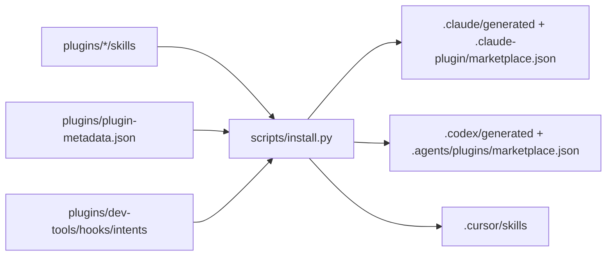

# Poseidon

**Claude Code、Codex、Cursor 共用的技能大仓：23 个技能覆盖开发提效、算法学习、简历求职与软考备考。**

技能只在 `plugins/` 下维护一份源码，由仓库安装器按目标平台生成插件清单、marketplace 与 hooks，避免多平台配置各自漂移。

## 目录

- [插件一览](#插件一览packages)
- [快速开始](#快速开始)
- [常用命令](#常用命令)
- [架构](#架构)
- [文档](#文档documentation)
- [参与开发](#参与开发contributing)
- [许可证](#许可证)

## 插件一览（Packages）

| 插件 | 适用场景 | 技能数 | 版本 | README |
|------|----------|--------|------|--------|
| `dev-tools` | 开发提效 — 代码实施、审查、计划、PR、变更集生成、文档同步、README 生成、诊断调试、桌面通知 | 9 | 0.3.0 | [README](plugins/dev-tools/README.md) |
| `algo-coach` | 算法学习 — LeetCode 题目初始化、hello-algo 知识点关联、解法优化 | 3 | 0.1.0 | [README](plugins/algo-coach/README.md) |
| `resume` | 简历与面试 — 项目经验提取、简历生成、多格式导出、面试准备 | 5 | 0.1.0 | [README](plugins/resume/README.md) |
| `outreach` | 求职触达 — 打招呼语生成、自动投递简历（BOSS直聘、remotecn 远程岗搜索） | 2 | 0.2.0 | [README](plugins/outreach/README.md) |
| `ruankao` | 软考备考 — 系统分析师论文写作、优化、帮记词、TTS 音频 | 4 | 0.1.0 | [README](plugins/ruankao/README.md) |

插件与版本以 [`plugins/plugin-metadata.json`](plugins/plugin-metadata.json) 为准。

## 快速开始

前置条件：Python 3（安装器只用标准库）与 `git`；走 Claude Code 或 Codex 插件流程时需已安装对应 CLI，Cursor 只需复制技能目录。

```bash
git clone https://github.com/HackNerd1/Poseidon.git
cd Poseidon
python3 scripts/install.py
```

不带参数会进入交互式安装：依次选择平台、插件、安装范围，确认后执行。安装器会读取 `plugins/plugin-metadata.json`，生成对应平台的插件包与 marketplace 清单，再调用平台 CLI 完成注册与安装。

非交互式的一次性安装：

```bash
python3 scripts/install.py --platform claude --scope user --plugin all
```

把 `--platform` 换成 `codex` 或 `cursor`、把 `--scope` 换成 `repo` 即可切换平台或装到当前项目。

生成物（`.claude/generated/`、`.codex/generated/`、`.cursor/skills/`、`.claude-plugin/marketplace.json`、`.agents/plugins/marketplace.json`）都在 `.gitignore` 中，修改技能后重跑安装器即可同步。

## 常用命令

| 命令 | 作用 |
|------|------|
| `python3 scripts/install.py` | 交互式安装 |
| `python3 scripts/install.py --platform claude --scope user --plugin all` | 非交互安装全部插件 |
| `python3 scripts/install.py --dry-run` | 只打印将要执行的操作，不写文件 |
| `python3 scripts/install.py --generate-only` | 只生成插件包与清单，不注册平台插件 |
| `python3 scripts/uninstall.py --platform claude --scope user --plugin all` | 卸载已安装插件 |
| `python3 scripts/validate.py --all` | 校验各平台打包结果与技能元数据 |

全部参数见 `python3 scripts/install.py --help`、`scripts/uninstall.py --help`、`scripts/validate.py --help`。

## 架构



`plugins/*/skills/` 是唯一的技能源码，`plugins/plugin-metadata.json` 是插件与 marketplace 元数据的唯一来源，`scripts/platforms.yaml` 描述各平台的安装路径与适配方式。hooks 同样只维护意图文件（`plugins/dev-tools/hooks/intents/*.yaml`），由安装器渲染成 Claude / Codex 的 `hooks.json`。设计与格式细节见 [架构文档](docs/architecture.md)。

## 文档（Documentation）

- [架构与 Skill 规范](docs/architecture.md) — Skill 目录与 frontmatter 格式、架构设计模式、大仓结构、编写最佳实践
- [Skill 编写最佳实践](docs/claude-agent-skills-best-practices.md) — 官方指南整理：简洁原则、Skill 结构、渐进式披露
- [岗位聚合平台需求](docs/requirements/job-feeds-aggregator.md) — auto-apply 的多平台岗位入口规划（待实现）

## 参与开发（Contributing）

- 新增或修改技能只改 `plugins/<插件>/skills/`，技能名使用小写连字符，并在 frontmatter 的 `description` 中写清触发条件。
- 插件版本、描述、关键词只改 `plugins/plugin-metadata.json`，不要手写 `.claude-plugin/plugin.json` 或 `hooks/hooks.json`，它们由安装器生成。
- 提交前运行 `python3 scripts/validate.py --all`，确认各平台打包结果与源码一致。
- 详细的 Skill 结构与写法参考 [架构文档](docs/architecture.md) 与 [最佳实践](docs/claude-agent-skills-best-practices.md)。

## 许可证

[MIT License](LICENSE)，Copyright (c) 2026 HackNerd1。
