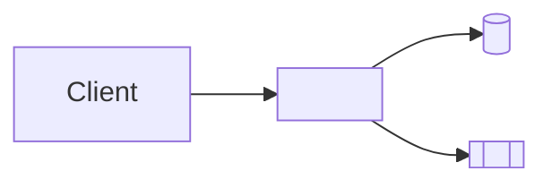

# README Module Library

Copy-paste building blocks and the selection handles used in the README plan. A module is an implementation of one section; the selected style template defines which sections are required and in what order.

## Default Module Sets

Use these as a starting point, then confirm the actual list with the user in the plan table.

| Style | Default modules | Typical optional additions |
|-------|-----------------|----------------------------|
| `library` | M1, M4, M5, M6, M9, M10, M16, M17 | M2 badges, M3 hero, M14 ownership (internal) |
| `cli` | M1, M4, M5, M6, M7, M9, M12, M13, M16, M17, M20 | M2 badges, M3 hero, M10 compatibility, M11 status |
| `app` | M1, M4, M5, M6, M7, M9, M11, M12, M16, M17 | M2 badges, M3 hero, M8 architecture, M14 ownership |
| `monorepo` | M1, M4, M5, M8, M9, M16, M17, M19 | M2 badges, M3 hero, M10 compatibility, M14 ownership |
| `internal-service` | M1, M7, M8, M9, M10, M12, M13, M14, M16, M17 | M2 badges (private-safe only), M3 hero, M6 usage, M11 status |

Optional visual/community modules (`M21`–`M36`: banner, tech icons, charts, star history, contributors, sponsors, roadmap, citation, security, and more) are listed in `references/optional-elements.md`. They are never enabled by default.

Rules:

- In the plan table, list module IDs explicitly (for example `M1,M5,M6,M17`).
- Use module IDs where a module exists; for template-specific sections without one, list the section name directly (for example `Release workflow`).
- Mark each module keep / revise / add / remove for existing files.
- Dropping a required section of the chosen style needs a stated reason.
- Delete scaffolding comments and unused alternatives before delivery.

## M1 — Header and Pitch

**Use when:** every README.

```md
# <project-name>

**<One sentence, ≤120 characters: what it is, who it is for, and the one differentiator.>**

<2–3 sentences: the problem, the approach, and the result. Link one unfamiliar concept if needed.>
```

Rules:

- The title matches the repository/package name. In a package README, use the published package name (for example `@acme/ui`).
- The pitch is a single sentence, not a feature list.
- The paragraph earns the next scroll; it does not repeat the pitch.

## M2 — Badge Row

**Use when:** the project has real CI, a published package, a supported-runtime matrix, and a license.

```md
[](https://github.com/<org>/<repo>/actions/workflows/ci.yml)
[](<registry-url>)
[](LICENSE)
```

Rules:

- 3–5 badges maximum; each one links to its source.
- Prefer static, locally hosted badges when the metric changes rarely.
- Delete the block for internal repos rather than exposing private metadata.

## M3 — Hero Media

**Use when:** a screenshot, GIF, or terminal recording explains the value faster than prose.

```md
<p align="center">
  .png" alt="<what the reader sees>" width="720">
</p>
```

Rules:

- Reference only a file that exists in the repo.
- Keep alt text descriptive; use `<picture>` only when light/dark variants genuinely help.
- If the asset is missing, omit the block and report it as a delivery gap.

## M4 — Feature Highlights

**Use when:** three to six capabilities differentiate the project.

```md
## Highlights

- **<Outcome>** — <what the user can now do; concrete, not a feature name>.
- **<Outcome>** — <second differentiator>.
- **<Outcome>** — <third differentiator>.
```

Rules:

- Lead with the outcome, not the implementation.
- Link a highlight to its detailed section or doc when one exists.
- Do not pad the list; three strong bullets beat ten generic ones.

## M5 — Quick Start / Installation

**Use when:** the project can be installed or launched by a reader.

````md
## Quick start

### Requirements

- <Runtime> <version>+
- <Optional system dependency>

```bash
# Default path — the one most readers should use
<install-command>
```

<One sentence: what just happened and what to run next.>

<details>
<summary>Other installation options</summary>

```bash
# <package manager / platform>
<alternative-command>
```

</details>
````

Rules:

- One default path first; alternatives after it, labeled.
- In a package README, the default path installs the package by its published name and the example imports its public entry point.
- Every command traces to a manifest, Makefile, CI file, or verified `--help`.
- Include prerequisites only when they are non-obvious.
- Keep the first working command within the first screen.

## M6 — Usage with Expected Output

**Use when:** the project has a runnable API, command, or workflow.

````md
## Usage

<One sentence introducing the smallest useful case.>

```bash
<minimal-command>
```

Expected output:

```text
<short, realistic output>
```

<Next step or link to the full guide.>
````

Rules:

- Start with the smallest complete example, then layer complexity.
- Keep transcripts short; trim irrelevant log lines with `...`.
- Match the command language exactly; do not paraphrase flags.

## M7 — Configuration Table

**Use when:** runtime behavior depends on environment variables, flags, or config keys.

```md
## Configuration

| Name | Default | Description |
|------|---------|-------------|
| `<ENV_VAR>` | `<safe default>` | <what it changes> |
| `<FLAG>` | `<default>` | <what it changes> |

Copy `.env.example` to `.env` and fill in the values locally. Never commit secrets.
```

Rules:

- List names and safe defaults only — never real tokens, URLs, or credentials.
- Mark required values explicitly.
- Link to the full configuration reference rather than listing every option.

## M8 — Architecture Diagram

**Use when:** the reader must understand components, data flow, or deployment topology before contributing or operating the project.

````md
## Architecture



<One paragraph: request path, ownership boundaries, and where to read more.>
````

Rules:

- Show the smallest diagram that explains the main path.
- Name real components from the repo; no decorative boxes.
- Link ADRs or deeper design docs.

## M9 — Docs Map ("Where to Go Next")

**Use when:** depth lives outside the README.

```md
## Documentation

- [Getting started](docs/getting-started.md) — <one-line scope>
- [API reference](docs/api.md) — <one-line scope>
- [Architecture](docs/architecture.md) — <one-line scope>
- [Contributing](CONTRIBUTING.md) — <one-line scope>
```

Rules:

- One line per link, each with a reason to click.
- Use relative links for repo files.
- Do not list docs that do not exist.

## M10 — Compatibility / Requirements

**Use when:** supported runtimes, platforms, or versions materially affect adoption.

```md
## Compatibility

| Runtime | Supported |
|---------|-----------|
| <runtime> | <version range> |
| <OS/platform> | <supported list> |
```

Rules:

- State only versions tested in CI or verified locally.
- Link the CI matrix or release notes as evidence.
- Date-gate claims that will drift.

## M11 — Status Callout

**Use when:** the project is alpha, experimental, deprecated, or access-restricted.

```md
> [!IMPORTANT]
> <Status: alpha / beta / maintenance-only / internal>. <What that means for the reader, and where to ask.>
```

Rules:

- Put it near the top, after the pitch.
- State the practical consequence, not just the label.
- Update or remove the callout when status changes.

## M12 — FAQ

**Use when:** the same questions recur in issues or onboarding.

```md
## FAQ

### <Question in the reader's words>

<Direct answer in 1–3 sentences. Link the authoritative doc if one exists.>
```

Rules:

- Answer real questions, not hypothetical ones.
- Keep answers short; link for depth.
- Remove questions once the docs answer them in place.

## M13 — Troubleshooting

**Use when:** setup has known failure modes with short fixes.

````md
## Troubleshooting

### <Symptom>

**Cause:** <one line>.

**Fix:**

```bash
<command or config change>
```
````

Rules:

- Organize by symptom, not by internal cause.
- Give a verifiable fix or a diagnostic command.
- Link the issue tracker for unresolved cases.

## M14 — Internal Service Status and Ownership

**Use when:** the README is for an internal service or team-owned platform.

```md
| Field | Value |
|-------|-------|
| Owner | <team> |
| Contact | <channel / alias> |
| On-call | <rotation or link> |
| Tier / SLO | <tier, availability target> |
| Data sensitivity | <classification> |
| Access | <how to request> |
```

Rules:

- Name a team and a real contact path.
- Link the service catalog, dashboards, and runbooks.
- Do not include credentials or internal hostnames that should not be in the README.

## M15 — Language Switcher

**Use when:** the project maintains more than one README.

```md
**English** | [简体中文](README.zh-CN.md)
```

Rules:

- Put it directly under the title or at the very top.
- When English is one of the languages, `README.md` holds English; otherwise it holds the primary language. Translations use `README.<bcp47>.md`.
- Keep section order and anchors aligned across variants.

## M16 — Contributing

**Use when:** the project accepts outside or cross-team contributions.

```md
## Contributing

Contributions are welcome. Read [CONTRIBUTING.md](CONTRIBUTING.md) for setup, test, and review requirements.

- Run `<test-command>` before opening a pull request.
- Use `<issue-template>` for bugs and feature requests.
```

Rules:

- State whether contributions are accepted.
- Give the real test/lint command.
- Link the code of conduct when one exists.

## M17 — License

**Use when:** every public project; internal projects use an explicit notice instead.

```md
## License

<SPDX identifier> © <owner>. See [LICENSE](LICENSE).
```

Internal variant:

```md
## License

Internal and proprietary. Not for external distribution.
```

Rules:

- Match the actual `LICENSE` file; never guess.
- Use an SPDX identifier when possible.
- License is the last section for public projects.

## M18 — Acknowledgments

**Use when:** contributors, sponsors, or upstream projects materially shaped the work.

```md
## Acknowledgments

- <Person/team> for <specific contribution>.
- <Upstream project> for <what it enables>.
```

Rules:

- Be specific; avoid generic thank-you lists.
- Link GitHub profiles or project pages.
- Keep it after contributing and before license.

## Assembly Checklist

- [ ] Every module uses a heading level consistent with its parent.
- [ ] No duplicate modules (one install block, one license block).
- [ ] Scaffolding comments and unused alternatives removed.
- [ ] All placeholders replaced.
- [ ] Local links and images resolve.
- [ ] Section order matches the selected template.

## M19 — Package Map

**Use when:** the README is the root of a monorepo.

```md
## Packages

| Package | Path | Purpose | README |
|---------|------|---------|--------|
| `@acme/ui` | `packages/ui` | <one-line purpose> | [README](packages/ui/README.md) |
| `@acme/theme` | `packages/theme` | <one-line purpose> | [README](packages/theme/README.md) |
| `showcase` | `apps/showcase` | <one-line purpose> | [README](apps/showcase/README.md) |
```

Rules:

- Include every in-scope package; omit skipped packages explicitly or list them separately.
- Link a README that exists; create it or remove the link otherwise.
- Group apps and packages when the distinction helps; keep one row per package.
- Do not duplicate this table with a full directory tree unless the tree adds non-package information.

## M20 — Command Reference

**Use when:** a CLI has more than a few commands.

````md
## Common commands

| Command | What it does |
|---------|--------------|
| `<command>` | <one-line purpose> |
| `<command> --<flag>` | <one-line purpose> |

```bash
<representative-command-with-output>
```

<Link to the full CLI reference for every flag.>
````

Rules:

- Show the commands a new user needs first, not every flag.
- Keep examples copy-paste ready and show expected output for the main one.
- Group by task when the list grows; link the complete reference.
