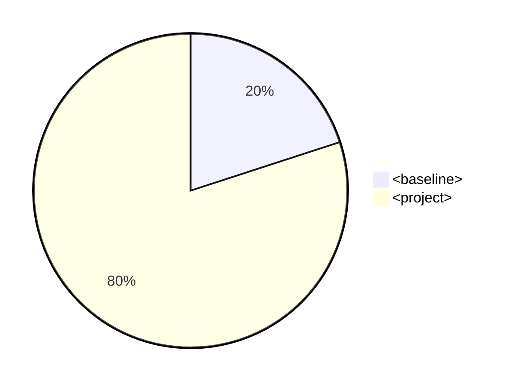

# Optional README Elements

Optional visual, credibility, community, and navigation modules. Load this file only when the user asks for extras (banner, icons, charts, badges, contributors, sponsors, roadmap) or when a public README would clearly benefit from them. None of these are required by a style contract.

Use module IDs `M21+` in the plan table alongside the core modules. Add an optional element only after the user approves it in the plan.

## Selection Menu

| Group | Module | Use when | Cost / risk |
|-------|--------|----------|-------------|
| **Visual** | M21 Banner / Logo | Public project with a brand or a strong visual identity | Adds asset weight; can dominate the first screen |
| **Visual** | M22 Tech Stack Icons | Readers need to recognize the stack at a glance | Icon licensing/trademark care; can become decoration |
| **Visual** | M23 Demo Video / Live Demo | The product is easier to show than to describe | Video can go stale; external hosting |
| **Visual** | M3 Hero Media (core) | A screenshot or terminal recording proves the value | Local asset must exist |
| **Credibility** | M24 Charts & Benchmarks | Performance, scale, or comparison is a core claim | Numbers need source, date, environment |
| **Credibility** | M25 Star History / Community Stats | The project has meaningful adoption history | Vanity risk; external service |
| **Credibility** | M26 Security Policy | The project accepts vulnerability reports | Must link a real policy |
| **Credibility** | M27 Citation | Academic or research users need to cite it | Must stay in sync with metadata |
| **Community** | M28 Contributors | The project wants to recognize contributors | Privacy/consent; avoid stale lists |
| **Community** | M29 Sponsors / Funding | The project accepts funding | Must be real; keep it quiet |
| **Community** | M30 Roadmap | Users need to know what is planned | Avoid promises and stale dates |
| **Community** | M31 Changelog / Releases | Users need version history | Link out; do not duplicate the changelog |
| **Community** | M32 Support / Getting Help | Users need a real support path | Dead channels hurt trust |
| **Navigation** | M33 Table of Contents | README is long or has many sections | Must update anchors |
| **Context** | M34 Background / Motivation | The project needs the "why" before the "how" | Can become an essay; link depth |
| **Context** | M35 Maintainers / Team | Users need to know who owns the project | Personal data care |
| **Community** | M36 Code of Conduct | The project accepts community participation | Link the real policy |

## Asset Rules

Apply to every image, icon, badge, chart, and video:

1. **Local first** — store screenshots, banners, and diagrams in `docs/assets/` or `assets/`; link relatively. Do not rely on personal CDN links that can disappear.
2. **Alt text** — every image needs concise alt text describing what the reader sees.
3. **Weight** — compress images; GitHub truncates rendered READMEs over 500 KiB and large media slows clones. Prefer SVG/WebP/PNG with reasonable dimensions. The audit warns for local images over 1 MiB.
4. **Dark/light** — if the asset only works on one background, provide both variants with `<picture>` and a fallback ``. GitHub supports `prefers-color-scheme` in Markdown HTML.
5. **Licensing** — use icons/logos you have the right to use; respect brand guidelines and attribution. Do not imply endorsement.
6. **Privacy** — strip metadata and internal URLs from screenshots; never show tokens, private hostnames, or personal data.
7. **Truth** — charts, benchmarks, star counts, and badges must link to their source and be current. A dynamic badge is not proof by itself.
8. **Accessibility** — sufficient contrast, no critical text baked only into an image, captions/transcripts for video.
9. **Stability** — pin versions or use static badges where a live metric would mislead after the project slows down.

## M21 — Banner / Logo

**Use when:** the first screen needs brand recognition and the project has an approved banner or logo.

```md
<p align="center">
  <picture>
    <source media="(prefers-color-scheme: dark)" srcset="docs/assets/banner-dark.png">
    <source media="(prefers-color-scheme: light)" srcset="docs/assets/banner-light.png">
     — <one-line description>" width="100%">
  </picture>
</p>
```

Rules:

- Keep one banner, not a stack of decorative images.
- Do not put essential information only in the image; repeat the project name and pitch in text.
- Use a wide, compressed asset; exact dimensions are not prescribed by GitHub.
- Link the banner to the docs or homepage only when that is genuinely useful.

## M22 — Tech Stack Icons

**Use when:** the stack is a meaningful selection signal and the list is short.

```md
<p align="center">
  <a href="https://react.dev"></a>
  <a href="https://www.typescriptlang.org"></a>
  <a href="https://vite.dev"></a>
</p>
```

Alternative with text + icon:

```md


```

Rules:

- Use 4–10 icons; a wall of logos is decoration, not information.
- Use official Simple Icons slugs and respect their legal disclaimer and brand guidelines.
- Put the technology name in `alt` and link to its official docs.
- Prefer the text+icon badge when the reader may not recognize a logo.
- Do not use icons to imply integration or endorsement that does not exist.

## M23 — Demo Video / Live Demo

**Use when:** the product has a visual workflow, UI, or terminal experience that is faster to show than to explain.

```md
**Live demo:** <https://<demo-url>>

[](<https://<video-url>>)
```

Terminal recording with asciinema:

```md
[](https://asciinema.org/a/<id>)
```

Rules:

- Keep the demo short and focused on one successful path.
- Provide a poster image and a text summary; do not autoplay.
- State whether the live demo is read-only, reset periodically, or requires an account.
- Re-record when the UI or CLI changes materially.

## M24 — Charts & Benchmarks

**Use when:** a performance, scale, or comparison claim is central to adoption.

Mermaid pie example (GitHub supports Mermaid flow, sequence, and pie diagrams):



Precise numbers are better as a table:

| Case | <metric> | Environment | Date |
|------|----------|-------------|------|
| <case> | <value> | <hardware/runtime> | <YYYY-MM-DD> |

Rules:

- Link the benchmark script, dataset, and raw results.
- State hardware, runtime version, dataset size, and date.
- Do not mix environments in one comparison.
- Prefer a table when exact values matter; use a chart only when the shape is the message.
- Never publish an unsourced chart.

## M25 — Star History / Community Stats

**Use when:** the project has a meaningful adoption history and the trend supports the story.

```md
<p align="center">
  <picture>
    <source media="(prefers-color-scheme: dark)" srcset="https://api.star-history.com/chart?repos=<owner>/<repo>&type=date&theme=dark&legend=top-left">
    <source media="(prefers-color-scheme: light)" srcset="https://api.star-history.com/chart?repos=<owner>/<repo>&type=date&legend=top-left">
    /<repo>&type=date&legend=top-left" alt="Star history for <owner>/<repo>">
  </picture>
</p>
```

Rules:

- Link the chart to its source.
- Use it only when the history is meaningful; a young or flat project gains nothing.
- Do not use stars as the main proof of quality; pair with working examples or benchmarks.
- Avoid it in internal/private repositories.

## M26 — Security Policy

**Use when:** the project accepts vulnerability reports or has supported-version obligations.

```md
## Security

Please do not report vulnerabilities in public issues. See [SECURITY.md](SECURITY.md) for supported versions and the private reporting process.
```

Rules:

- Link a real `SECURITY.md`; include supported versions and the reporting channel.
- Do not publish a personal email without consent; use the project's security alias.
- Keep the policy current when support windows change.

## M27 — Citation

**Use when:** academic, research, or data users need a citation.

````md
## Citation

If you use <project> in academic work, please cite it:

```bibtex
@software{<key>,
  title = {<project>},
  author = {<authors>},
  year = {<year>},
  url = {<url>}
}
```

See [CITATION.cff](CITATION.cff) for the machine-readable record.
````

Rules:

- Keep the README and `CITATION.cff` in sync.
- Include a DOI or preferred citation when one exists.
- GitHub surfaces `CITATION.cff` in the repository sidebar; the README block is a convenience, not a replacement.
- Do not invent author order or publication metadata.

## M28 — Contributors

**Use when:** the project wants to recognize contributors and has a stable contributor base.

```md
## Contributors

Thanks to everyone who has contributed.

[View contributors](https://github.com/<owner>/<repo>/graphs/contributors)
```

Optional manual list:

```md
- @<handle> — <area>
- @<handle> — <area>
```

Rules:

- Prefer the GitHub contributors graph over scraping avatars.
- Get consent before listing personal names or contact details.
- Do not list inactive contributors as if they are current maintainers.
- Keep maintainer roles in M35, separate from thanks.

## M29 — Sponsors / Funding

**Use when:** the project has real funding channels.

```md
## Sponsors

<a href="https://github.com/sponsors/<user>"></a>
```

Rules:

- Configure `.github/FUNDING.yml`; the README badge should match a real channel.
- Keep sponsorship near the end, not in the first screen.
- Thank sponsors by name only with permission.
- Never imply that funding buys support or roadmap priority unless that is true.

## M30 — Roadmap

**Use when:** users need to know the direction and the project can keep the list current.

```md
## Roadmap

- [x] <shipped capability>
- [ ] <next capability> — <issue link>
- [ ] <later capability>
```

Rules:

- Link each item to an issue or discussion when possible.
- Use dates only when they are commitments.
- Remove or mark abandoned items; a stale roadmap is worse than none.
- Keep the list short; details belong in the issue tracker.

## M31 — Changelog / Releases

**Use when:** users need version history or upgrade notes.

```md
## Changelog

See [CHANGELOG.md](CHANGELOG.md) or the [releases page](https://github.com/<owner>/<repo>/releases).
```

Rules:

- Link out; do not duplicate the changelog in the README.
- Follow Keep a Changelog and semantic versioning when applicable.
- Show the current release badge only if it is live and maintained.

## M32 — Support / Getting Help

**Use when:** users need a real path for questions, bugs, or commercial help.

```md
## Support

- **Questions:** <discussions or chat link>
- **Bugs:** <issue tracker link>
- **Security:** see [SECURITY.md](SECURITY.md)
- **Commercial support:** <link or "not offered">
```

Rules:

- Link only channels that are monitored.
- State expected response times only if they are real.
- Separate security reports from public issues.
- Do not route users to a dead chat or an unread inbox.

## M33 — Table of Contents

**Use when:** the README is 100+ lines or has more than five level-two sections.

```md
## Table of contents

- [Install](#install)
- [Quick start](#quick-start)
- [Usage](#usage)
- [Configuration](#configuration)
- [License](#license)
```

Rules:

- Keep entries in document order.
- Update anchors after renaming headings.
- Do not nest more than two levels unless the document is genuinely deep.
- GitHub generates an outline automatically, but an explicit TOC still helps clones and non-GitHub hosts.

## M34 — Background / Motivation

**Use when:** the reader needs the "why" before the "how" — a new category, a replacement, or a research project.

```md
## Background

<The problem, why existing options fall short, and the approach. Link the design note or ADR for depth.>
```

Rules:

- Keep it to a few paragraphs; move long history to `docs/`.
- Name alternatives only when the comparison is fair and sourced.
- Do not repeat the pitch; add context.

## M35 — Maintainers / Team

**Use when:** users need to know who owns the project and how decisions are made.

```md
## Maintainers

- @<handle> — <area>
- @<handle> — <area>

See [GOVERNANCE.md](GOVERNANCE.md) for decision-making.
```

Rules:

- List current maintainers only; update when roles change.
- Link a governance or ownership doc when one exists.
- Do not publish personal emails without consent.
- For internal services, use M14 instead (ownership, on-call, SLO).

## M36 — Code of Conduct

**Use when:** the project accepts community participation.

```md
## Code of Conduct

This project follows the [Contributor Covenant](https://www.contributor-covenant.org/). See [CODE_OF_CONDUCT.md](CODE_OF_CONDUCT.md) for reporting and enforcement.
```

Rules:

- Link the actual policy file and enforcement contact.
- Keep the linked version current.
- Do not claim a code of conduct you do not enforce.

## Sources

All sources accessed 2026-11-25.

| Source | URL | Takeaway |
|--------|-----|----------|
| Shields.io | https://shields.io/ | Static and dynamic badges; consistent badge language |
| Simple Icons | https://github.com/simple-icons/simple-icons | Brand SVG icons, CDN usage, slugs, legal disclaimer |
| Star History | https://github.com/star-history/star-history | Embeddable star-history chart via `api.star-history.com` |
| GitHub: Mermaid diagrams | https://docs.github.com/en/get-started/writing-on-github/working-with-advanced-formatting/creating-diagrams | Mermaid fenced blocks; flow, sequence, pie |
| GitHub: Citation files | https://docs.github.com/en/repositories/managing-your-repositorys-settings-and-features/customizing-your-repository/about-citation-files | `CITATION.cff`; sidebar citation |
| GitHub: Security policy | https://docs.github.com/en/code-security/getting-started/adding-a-security-policy-to-your-repository | `SECURITY.md`; supported versions and reporting |
| GitHub: Sponsor button | https://docs.github.com/en/repositories/managing-your-repositorys-settings-and-features/customizing-your-repository/displaying-a-sponsor-button-in-your-repository | `.github/FUNDING.yml`; funding links |
| asciinema | https://asciinema.org/ | Terminal recordings; embeddable player |
| Make a README | https://www.makeareadme.com/ | Badges, visuals, roadmap, support, authors |
| Standard Readme | https://github.com/RichardLitt/standard-readme/blob/main/spec.md | Banner, badges, security, background, maintainers, thanks |
| Awesome README | https://github.com/matiassingers/awesome-readme | Visuals, navigation, badges, demos, community links |
