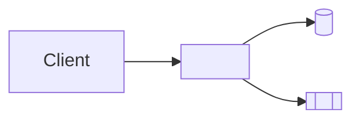

<!--
TEMPLATE: internal-service
Use for private, team-owned services and platforms.
Optional banner/icons/charts/community modules: see references/optional-elements.md (M21+).
Fill every <...>. Delete guidance comments and unused optional sections.
Never include credentials, private hostnames, or personal data.
-->
# <service-name>

**<One sentence: what the service does and which users/systems depend on it.>**

| Field | Value |
|-------|-------|
| Owner | <team> |
| Contact | <channel / alias> |
| On-call | <rotation or link> |
| Tier / SLO | <tier, availability target> |
| Data sensitivity | <classification> |
| Access | <how to request> |

## Overview

<2–3 sentences: the business capability, the boundary of responsibility, and what this service explicitly does not own.>

## Architecture



<One paragraph: main request path, synchronous/asynchronous boundaries, and failure behavior.>

### Dependencies

| Dependency | Type | Why it matters |
|------------|------|----------------|
| <service/store> | <sync/async> | <impact if unavailable> |

## Local development

### Requirements

- <Runtime> <version>+
- <Database/queue dependency>

```bash
<setup-command>
<run-command>
```

Verify:

```bash
<health-check-command>
```

## Configuration

| Name | Default | Required | Description |
|------|---------|----------|-------------|
| `<ENV_VAR>` | `<safe default>` | <yes/no> | <what it changes> |

Secrets live in <secret manager>. Never commit values to the repo.

## Testing

```bash
<unit-test-command>
<integration-test-command>
```

<One sentence: what the integration suite requires and where it runs in CI.>

## Deploy and release

<One paragraph: pipeline, environments, approval gates, and rollback path. Link the deploy runbook.>

## Operations

| Resource | Link |
|----------|------|
| Dashboard | <link> |
| Alerts | <link> |
| Logs | <link> |
| Runbook | <link> |
| Service catalog | <link> |

### Known failure modes

- **<Failure mode>** — <symptom, first diagnostic step, and runbook section>.

## API

<Link to the API reference or OpenAPI spec. Summarize only the primary endpoints if needed.>

## Security and data

<Data classification, retention, access model, and compliance constraints. Link the threat model or security review.>

## Decision records

- [ADR-<n>: <title>](docs/adr/<file>.md) — <one-line decision summary>

## Contributing

<Team workflow for changes, review requirements, and how to request access.>

## License

Internal and proprietary. Not for external distribution.
